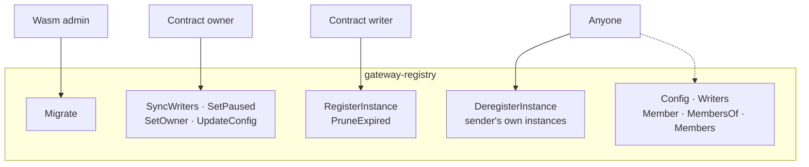
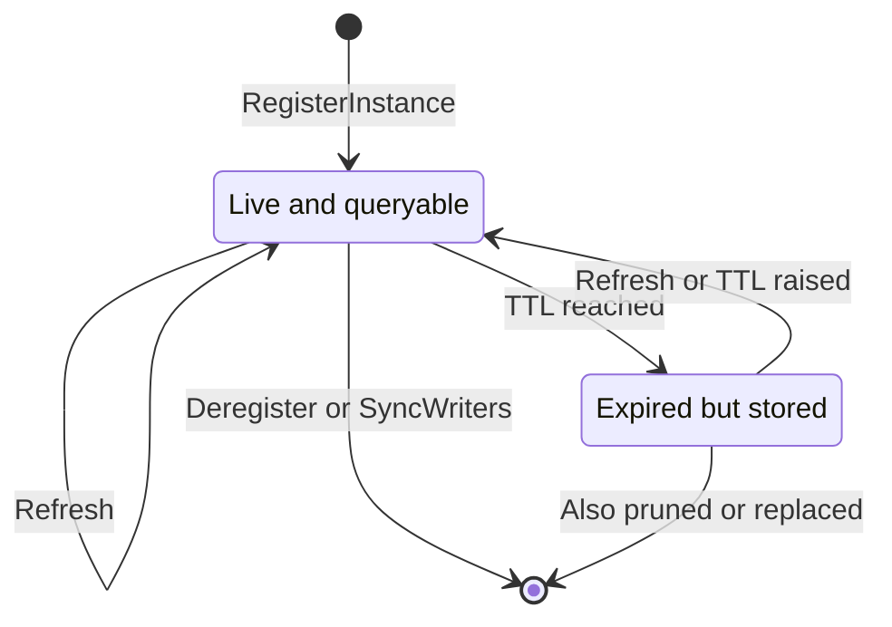

# Gateway Registry Contract

CosmWasm registry of gateway peer instances: each allowlisted address publishes the endpoint, transport key fingerprint, protocol and topics of its instances.

## Overview

The arrows show who may call each operation. The wasm admin is a chain-level role, separate from the contract owner. Writers are the addresses in the contract's own list, which only `SyncWriters` changes; it is separate from the chain parameter `allowed_creator_addresses` that gateways read, so being allowlisted on chain grants no write here.



Anyone can query, and `Member`, `MembersOf` and `Members` return live instances only. `SyncWriters` also deletes the instances of removed addresses.

Expiry hides an instance from those queries but does not delete it. Refreshing means `RegisterInstance` with the same id, at most once per `min_update_interval_blocks`. Raising `instance_ttl_blocks` also brings an expired instance back.



Deregistering and `SyncWriters` remove an expired instance the same way as a live one. Only expired instances are pruned, and a new instance id at an address over its limit replaces that address's oldest expired ones.

## Rules

- `RegisterInstance` is writer only and upserts one instance of the sender, at most once per `min_update_interval_blocks` per instance and at most `max_instances_per_address` per address.
- An instance is expired when `height - updated_height >= instance_ttl_blocks` (16200). Queries skip expired instances at once; they are deleted lazily, up to 10 by each `RegisterInstance` or up to 100 by `PruneExpired`, oldest first.
- `SyncWriters`, `SetPaused`, `SetOwner` and `UpdateConfig` are owner only. `SyncWriters` deletes all instances of removed addresses.

## Changing the limits

`UpdateConfig` replaces `max_endpoint_len`, `max_topics`, `max_instances_per_address`, `min_update_interval_blocks`, `instance_ttl_blocks` and `prune_per_write` together, and refuses what instantiate refuses. Every field is required. It deletes nothing, and each new limit applies from its next use:

- A write is held to the limits in force at its height. A stored instance past a lowered `max_endpoint_len` or `max_topics` stays readable, and its next refresh must fit.
- An address over a lowered `max_instances_per_address` keeps its instances and can refresh them. A new instance id needs room: its expired instances are replaced oldest first as far as that makes it fit, and otherwise the write fails with `TooManyInstances`.
- A changed `instance_ttl_blocks` applies to every stored instance at once, to queries and to pruning alike, so lowering it can expire instances immediately and raising it can bring back ones not yet deleted.

`instance_ttl_blocks` is at most 5913000, about a year of blocks, and `min_update_interval_blocks` stays below it. A chain height fits an `i64`, so adding the interval to a stored height cannot overflow.

The gateway has its own copies of four of these and of the refresh that keeps an entry alive: it filters by a TTL of 16200 blocks, writes endpoints of up to 256 bytes, keeps at most 16 instances per address and reregisters every 4050 blocks. Lowering `instance_ttl_blocks` or `max_endpoint_len` below those, raising `max_instances_per_address` above 16, or raising `min_update_interval_blocks` above 4050, needs a gateway release first.

## Deploying and upgrading

Instantiate with a wasm admin, because a contract instantiated with `--no-admin` can never change its code. The admin is a chain-level role, separate from the contract's `owner`: `SetOwner` does not move it, and `tx wasm set-contract-admin` does.

```bash
inferenced tx wasm store artifacts/gateway_registry.wasm --from <deployer>
inferenced tx wasm instantiate <CODE_ID> '{"owner":"<OWNER>","writers":[],"max_endpoint_len":256,"max_topics":16,"max_instances_per_address":16,"min_update_interval_blocks":100}' --label gateway-registry --admin <ADMIN> --from <deployer>
```

To upgrade, store the new code and migrate from the admin account. The contract keeps its address, writers, config and instances.

```bash
inferenced tx wasm store artifacts/gateway_registry.wasm --from <deployer>
inferenced tx wasm migrate <CONTRACT> <NEW_CODE_ID> '{}' --from <ADMIN>
```

`migrate` only records the new contract version, so a release that changes the layout of stored state has to convert it there.

## Build

`make build` runs the CosmWasm optimizer in Docker. `cargo test` runs the cw-multi-test suite. `cargo run --bin schema` writes the JSON schema to `schema/`, which is not checked in.
